# Nostrautica — Príručka organizátora

Nostrautica je aplikácia pre podujatia postavená na jednej myšlienke: **najdôležitejšie na vašom podujatí je, kto koho stretne**. Účastníci si nahrajú krátke predstavovacie video a voliteľný AI koordinátor im na základe neho povie, s kým by sa mali porozprávať a prečo. Táto príručka vás prevedie od úplného začiatku až po bežiace podujatie.

## Čo vás čaká

1. Vytvorenie identity (raz).
2. Vytvorenie podujatia — voliteľne rovno s pripojeným AI koordinátorom, alebo neskôr.
3. Zdieľanie podujatia — otvorený odkaz, pozývacie kódy, alebo oboje.
4. Schvaľovanie účastníkov (alebo necháte pozývacie kódy schvaľovať automaticky).
5. Zverejňovanie noviniek, úprava vzhľadu stránky podujatia a beh podujatia.

Všetko beží vo vašom prehliadači. Nič netreba nastavovať na serveri — aplikácia ukladá dáta podujatia zašifrované na otvorenej sieti Nostr. Kľúče podujatia drží váš prehliadač, preto **používajte jeden prehliadač, ktorý si necháte** (a keď vás na to aplikácia vyzve, zálohujte si identitu).

> **Poznámka k usporiadaniu aplikácie.** Keď ste vnútri podujatia, spodná lišta je *viazaná na dané podujatie* — **Prehľad**, **Ľudia**, **Spojenia**, **Novinky** a **Viac** sa vzťahujú na podujatie, v ktorom práve ste, a kompaktná hlavička nad nimi ukazuje jeho názov a váš status. Vaše globálne veci (všetky vaše podujatia, správy, nastavenia, vaša identita) sú v ponuke **Viac**. Ako organizátor tam navyše nájdete **Správa podujatia**, ktorá otvorí administráciu popísanú v §3.

## 1. Vytvorenie identity

Otvorte aplikáciu. Na úvodnej obrazovke napíšte svoje meno a klepnite na **Vytvoriť moju identitu** (môžete pridať aj fotku). Žiadny e-mail, žiadne heslo — účet vznikne okamžite. Ak už Nostr používate, klepnite na **Už ste na Nostri? Prihláste sa** a namiesto toho použite svoj kľúč, rozšírenie prehliadača alebo vzdialený podpisovač.

> **Tip:** tento krok nemusíte robiť samostatne — ak sa odhlásení rovno pustíte do vytvárania podujatia, aplikácia si vašu organizátorskú identitu vytvorí v rámci toho istého odoslania.

Keď sa vaša identita vytvorí, zobrazí sa vám **záložná karta**. Urobte to hneď: klepnite na **Kopírovať môj tajný kľúč** a vložte ho niekam bezpečne (do správcu hesiel). Kto má tento kľúč, *je* vami; bez neho stratený profil prehliadača znamená stratené podujatie. Ponuka „Ďalšie spôsoby zálohovania" ponúka aj obnovovací odkaz e-mailom alebo súbor chránený heslom.

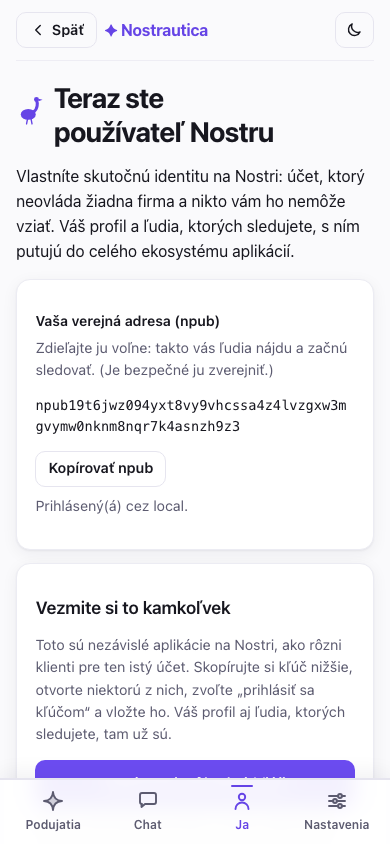

## 2. Vytvorenie podujatia

Zvoľte **Vytvoriť podujatie** a vyplňte formulár:

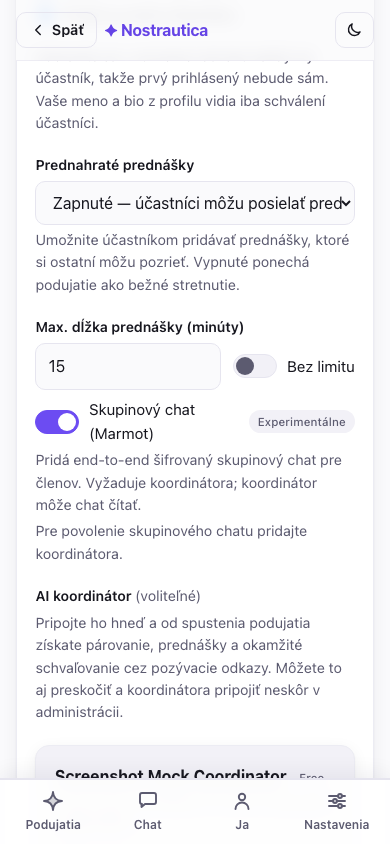

- **Názov, zhrnutie, začiatok/koniec, miesto** — verejne viditeľné pre kohokoľvek s odkazom.
- **Schvaľovanie** — ako sa ľudia dostanú dnu:
  - *Manuálne posúdenie*: každá žiadosť čaká na vaše schválenie.
  - *Iba pozývacie kódy*: dnu sa dostanete len cez pozývací odkaz, inak nijako.
  - *Pozývacie kódy + manuálne*: pozývacie odkazy schvaľujú automaticky (keď je pripojený koordinátor); ostatní čakajú na vás. **Odporúčané pre väčšinu podujatí.**
- **Jazyk podujatia** — pozri nižšie.
- **AI párovanie** — nastavte na *Zapnuté*, ak plánujete pripojiť koordinátora (§5). Koordinátora môžete pripojiť aj neskôr; toto nastavenie nechajte teraz zapnuté.
- **AI koordinátor** (voliteľné) — vyberte si ho rovno tu na formulári, ten istý zoznam ako v §5, takže podujatie s pozývacími kódmi môže schvaľovať automaticky a párovať hneď od spustenia. Preskočte to a pripojte koordinátora neskôr cez **Administrácia → Nastavenia**, ak sa chcete rozhodnúť až podľa toho, ako sa podujatie zapĺňa — na zvyšku formulára to nič nemení.

  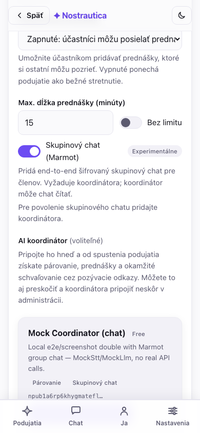
- **Pridať sa medzi účastníkov** — predvolene zaškrtnuté: ste zapísaní ako ktorýkoľvek iný účastník, takže prvý človek, ktorý sa pripojí, uvidí v zozname **Ľudia** aspoň vás namiesto prázdneho zoznamu (a raz, keď nahráte predstavenie, môžete byť aj vy niekomu spárovaní). Vaše meno a bio vidia len schválení účastníci; odškrtnite to, ak chcete podujatie organizovať bez toho, aby ste sa objavili v zozname.
- **Rozšírené** (zbalené) — nahratie ikony a banneru podujatia (inak sa vygenerujú z názvu) a nastavenie limitu dĺžky predstavovacieho videa.

### Jazyk podujatia

Vyberte jazyk, v ktorom vaše podujatie beží. Začnite písať a vyhľadajte ho — podľa názvu jazyka vo vašom vlastnom jazyku *alebo* podľa dvojpísmenového kódu (napíšte „slov" alebo „sk" a nájdete slovenčinu). Váš vlastný jazyk, jazyky preferované vaším prehliadačom a angličtina/slovenčina/čeština sú pripnuté navrchu; zvyšok nasleduje abecedne.

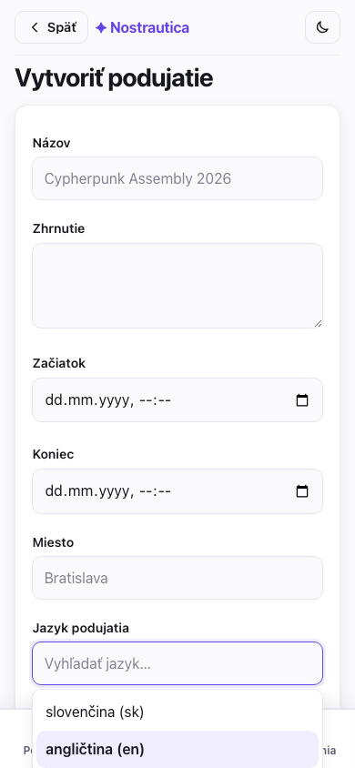

Jazyk robí tri veci. Nastavuje **predvolený jazyk rozhrania** pre účastníkov, ktorí otvoria vaše podujatie (aj tak si ho môžu prepnúť v Nastaveniach). Nastavuje jazyk, v akom píše AI: **odôvodnenia spojení a zhrnutia profilov sú vždy v jazyku vášho podujatia**, bez ohľadu na to, akým jazykom daný účastník skutočne hovorí alebo v akom nahráva — niekto môže nahrať svoje predstavenie po anglicky na slovenskom podujatí a všetci si aj tak prečítajú, prečo by sa s ním mali stretnúť, po slovensky. A keď účastník napíše svoje bio v inom jazyku, koordinátor **zverejní preklad do jazyka podujatia**, aby si ho vedel prečítať zvyšok miestnosti — pôvodný text danej osoby zostáva vždy zachovaný a zobrazený tiež. Predvolená je angličtina; pre anglické podujatie ju nemeňte.

(Nič kvôli tomu nikdy nemusíte spúšťať znova: keď účastník aktualizuje svoje predstavenie, systém automaticky prepočíta iba spojenia, ktorých je súčasťou.)

Všimnite si poznámku pod formulárom: **rotácia kľúčov funguje len dopredu** — ktokoľvek niekedy držal dešifrovací kľúč, dokáže dešifrovať obsah zverejnený, kým bol tento kľúč platný. Odobratie niekoho (§4) chráni *budúci* obsah, nie minulý.

Po vytvorení dostanete **odkaz na zdieľanie** a kontrolný zoznam ďalších krokov. Uložte si odkaz — používa ho každý účastník.

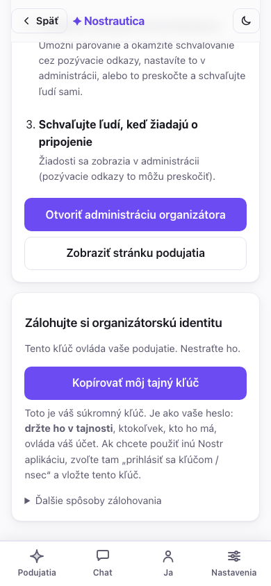

## 3. Otvorenie administrácie a zdieľanie

Klepnite na **Otvoriť administráciu organizátora** (kedykoľvek dostupné aj cez **Viac → Správa podujatia**). Ovládací panel má dve karty, takže bežná prevádzka podujatia nikdy neznamená rolovať cez jednorazové nastavenia:

- **Administrácia** — karta, na ktorej pristanete, a tá, na ktorú sa budete vracať najčastejšie: stavový riadok (počet čakajúcich, s odkazom na jedno klepnutie), **žiadosti o pripojenie** úplne navrchu, generovanie pozývacích kódov, zoznam schválených účastníkov (odobrať/spracovať znova), moderovanie prednášok a **Komunikácia** (príspevky/novinky).
- **Nastavenia** — jednorazové veci pre dané podujatie: AI koordinátor (§5), menu a rozloženie stránky podujatia, vzhľad/téma CSS, režim prednahratých prednášok, skupinový chat a spoluorganizátori. Ak ste koordinátora vybrali už na formulári pri vytváraní (§2), tu už uvidíte, že je pripojený.

Čerstvé podujatie, zatiaľ žiadne žiadosti:

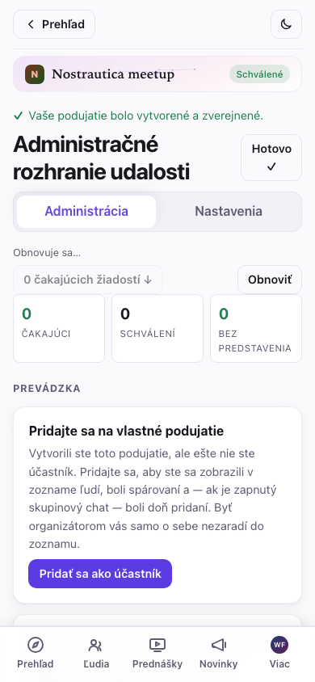

Na zdieľanie máte dva druhy odkazov:

- **Otvorený odkaz na podujatie** (`…#/e/<podujatie>/join`, zobrazený bližšie k spodku s tlačidlom **Kopírovať pozývací odkaz**) — ktokoľvek si môže pozrieť verejnú stránku podujatia a požiadať o pripojenie. Dajte ho na svoj web alebo sociálne siete.
- **Pozývacie kódy** — jednorazové odkazy, ktoré držiteľa automaticky schvália *keď je pripojený koordinátor*. Nastavte počet a klepnite na **Vygenerovať**; dostanete jeden odkaz + QR kód na kód. Pošlite jeden na osobu, alebo vytlačte QR kódy. Kód sa nesie vo fragmente URL a nikdy sa nedostane na server — s každým odkazom zaobchádzajte ako s lístkom.

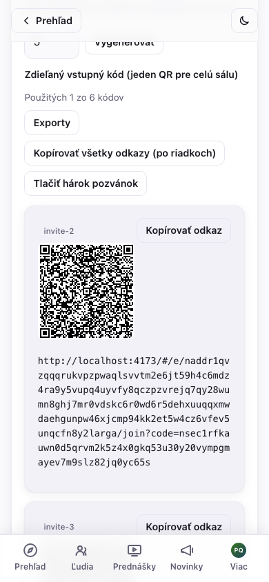

## 4. Schvaľovanie účastníkov

Žiadosti o pripojenie sa objavujú v sekcii **Žiadosti o pripojenie** — každá zobrazuje meno osoby, krátke id, jej zručnosti, značku **pozvánka**, ak použila kód, a značku 🎥, ak už nahrala predstavenie. Tlačidlo „N čakajúcich žiadostí ↓" navrchu vás tam presunie.

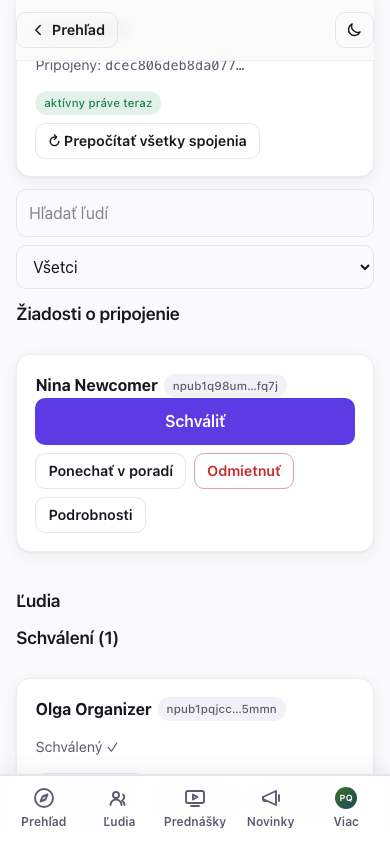

Klepnite na **Schváliť** pri ľuďoch, ktorých chcete vpustiť — alebo na **Schváliť všetky (N)**, keď čaká viacero. Schválení ľudia sa presunú do sekcie **Schválení**. Každá schválená karta má **Spracovať znova** (znovu zverejní záznam v adresári / prepočíta spojenia) a **Odobrať**.

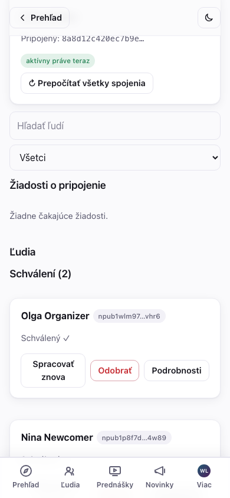

Schválení účastníci získajú prístup k zašifrovanému zoznamu účastníkov, predstavovacím videám ostatných a (s pripojeným koordinátorom) svojim spojeniam.

> **Aktualizácia (17. 7. 2026):** chyba pri schvaľovaní bez koordinátora, opísaná v skoršej verzii tejto príručky, je opravená — schválenie niekoho bez pripojeného koordinátora sa teraz bežne dostane na jeho zariadenie. Pripojenie koordinátora (§5) sa stále oplatí kvôli automatickému schvaľovaniu a spojeniam, ale už nie je nutné len na to, aby fungovalo manuálne schvaľovanie.
>
> Jedna zostávajúca drobnosť: ak si po schválení upravíte vlastný napísaný text predstavenia, ostatní účastníci ho uvidia až vtedy, keď vy (alebo koordinátor) váš záznam tu v zozname Ľudia **spracujete znova** — zatiaľ sa to nešíri automaticky.

### Odobratie niekoho

Klepnite na **Odobrať** pri schválenej karte. Dostanete potvrdenie vysvetľujúce dôsledok:

> *„Odobrať {meno}? Stratí prístup ku všetkému novému. To, čo už videl, sa vziať späť nedá."*

Potvrdenie automaticky otočí kľúč podujatia pre všetkých ostatných, takže odobratá osoba nedokáže dešifrovať nič zverejnené od tohto bodu ďalej. To, čo už videla, sa nedá „odvidieť" — ak si nie ste istí, odoberte skôr.

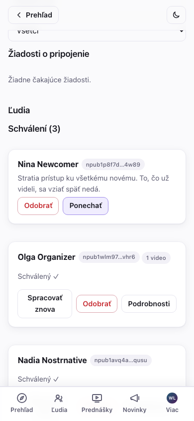

## 5. Pripojenie AI koordinátora (párovanie)

Koordinátor je malá služba, ktorá prepisuje predstavovacie videá, zostavuje profil každého účastníka a počíta, kto by mal koho stretnúť. Bez neho podujatie stále plne funguje — zoznam účastníkov, videá, sledovania — len bez automatických spojení a pozývacie odkazy potrebujú vaše manuálne schválenie.

Vybrať si ho môžete rovno na formulári pri vytváraní (§2), aby bežal od začiatku, alebo ho pripojiť neskôr — rovnaký zoznam, len na inom mieste: pri existujúcom podujatí je to v **Administrácia → Nastavenia → AI koordinátor**, nie v Administrácii (tá karta je pre veci, ktoré robíte opakovane; pripojenie koordinátora je jednorazové nastavenie). Tak či onak si **vyberiete koordinátora zo zoznamu** — každý sa na Nostri ohlasuje svojím menom, funkciami, zverejnením ochrany súkromia (ktoré kroky AI opúšťajú zabezpečenú enklávu) a svojím cenníkom (referenčný koordinátor je **Zdarma**). Klepnite na **Použiť tohto koordinátora**:

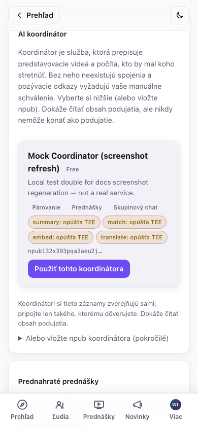

Chcete prevádzkovať vlastného, alebo vám bol daný konkrétny? Rozbaľte **Alebo vložte npub koordinátora (pokročilé)** a namiesto toho vložte jeho verejný kľúč. Tak či onak uvidíte potvrdenie:

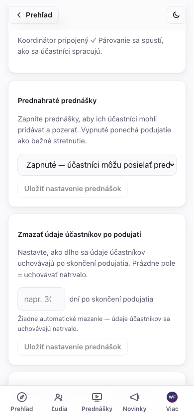

> **Platení koordinátori.** Koordinátor môže byť spoplatnený (náklady na AI párovanie rastú s počtom účastníkov), takže záznam môže zobrazovať cenu alebo bezplatnú úroveň (napr. „do 20 účastníkov zadarmo"). Ak je niekedy potrebná platba, obrazovka Nastavení zobrazí banner **Vyžaduje sa platba** s odkazom na platbu — súčasný referenčný koordinátor je zdarma.

Koordinátor obsah podujatia iba *číta* — nikdy nemôže konať namiesto podujatia ani schvaľovať ľudí nad rámec pravidiel, ktoré ste nastavili. Po pripojení sa na karte **Administrácia** objaví tlačidlo **↻ Prepočítať všetky spojenia** (je to opakovaná akcia, nie nastavenie); použite ho po nápore nových účastníkov.

> Spustenie koordinátora je samostatný, technický krok (malý démon, ktorý potrebuje `ffmpeg` a kľúč k poskytovateľovi LLM/prepisu reči). Pozrite si [`packages/coordinator/coordinator.example.toml`](../packages/coordinator/coordinator.example.toml) a README repozitára. Jeho relaye nasmerujte na ten istý relay, ktorý používa vaše podujatie.

## 6. Zverejňovanie príspevkov pre účastníkov

Karta **Príspevky podujatia** (v administrácii pod **Komunikácia**) je váš oznamovací kanál — „program je hotový", „zmena miesta konania", „dnešná večera je o…". Zadajte titulok a voliteľné zhrnutie/hlavičkový obrázok, napíšte text (**funguje Markdown** — nadpisy, zoznamy, odkazy, tučné písmo) a vyberte, **kto ho môže čítať**:

- **Verejný** — vidí ho ktokoľvek s odkazom na podujatie, prihlásený aj neprihlásený. Ide o štandardné dlhé Nostr príspevky zverejnené pod identitou podujatia, takže sú viditeľné aj v iných Nostr čítačkách.
- **Len pre členov** — zašifrovaný pre vašich schválených účastníkov. Neschválení (aj verejnosť) vidia iba zámok a výzvu „pripojte sa k podujatiu a prečítajte si toto", nikdy obsah. Použite to na adresu afterparty, kód od dverí, čokoľvek, čo má zostať vnútri miestnosti.

Klepnite na **Zverejniť príspevok**. Viditeľnosť je po zverejnení pevná (text môžete neskôr upraviť, ale verejný príspevok sa potichu nedá prepnúť na len pre členov a naopak). Priamo z výberu v editore môžete tiež vložiť odkaz na existujúci príspevok a pripnúť príspevok navrch stránky podujatia.

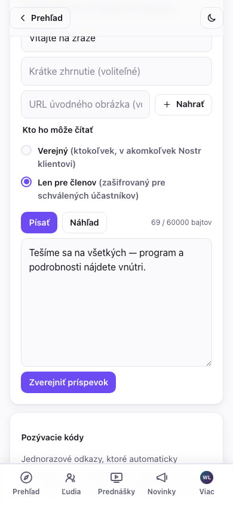

Verejné príspevky sa zobrazujú na **stránke podujatia** pre každého; príspevky len pre členov sa schváleným účastníkom zobrazujú v **Novinkách** a v pruhu „Posledné" na **Prehľade** podujatia, označené visiacim zámkom. Takto vyzerá zámok príspevku len pre členov účastníkovi, ktorý sa ešte nepripojil:

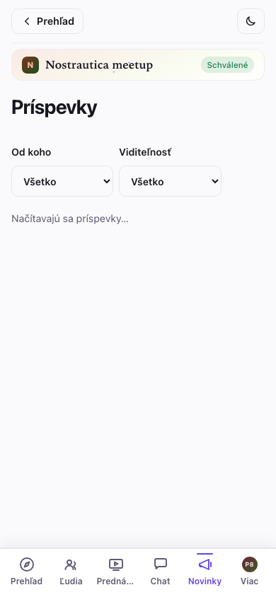

### Prispôsobenie stránky podujatia a jej vzhľadu

V **Administrácia → Nastavenia** sú ešte dva ovládacie prvky:

- **Stránka podujatia** (kind 31608) — namiesto predvoleného rozloženia si zostavíte vlastné menu a usporiadate sekcie (ktoré príspevky sa kde zobrazujú) na verejnej stránke podujatia. Poradie meníte pomocou tlačidiel ↑/↓.
- **Vzhľad** (kind 31609) — vložíte vlastné CSS a naladíte vzhľad stránok *tohto podujatia*. Pred **Zverejnením vzhľadu** máte živý **Náhľad**; opustenie administrácie bez zverejnenia obnoví posledný uložený vzhľad. Vrství sa nad vstavaným farebným nádychom aplikácie pre dané podujatie, takže stačí málo. (Vkladajte len CSS, ktoré ste napísali sami alebo ktorému dôverujete — štýluje stránku každému účastníkovi.)

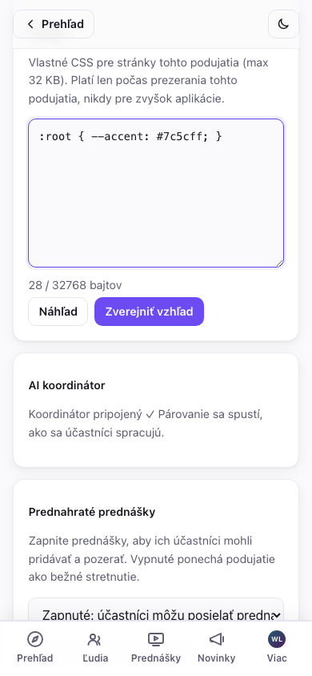

## 6.5 Prednášky a skupinový chat (obe novinky, obe voliteľné)

**Prednahraté prednášky.** V **Administrácia → Nastavenia → Prednahraté prednášky** to prepnite na *Zapnuté* (alebo *Najprv prednahraté*, čo v navigácii účastníkov posunie Prednášky pred Ľudí — vhodné pre formát „pozrite si vopred, stretnite sa na mieste") a **Uložte**. Schválení účastníci potom môžu posielať krátke prednášky z toho istého editora ako pri predstavení.

Odoslané prednášky sa samé nezverejnia. Karta **Moderovanie prednášok** nižšie v **Administrácii** zobrazuje všetko, čo čaká na kontrolu — pri každej klepnite na **Ukážka**, potom ju buď **Zverejnite**, aby si ju účastníci mohli pozrieť, alebo **Zamietnite**. Kým to tu neurobíte, nikto okrem vás nič, čo účastník pošle, neuvidí (zverejnenie navyše potrebuje pripojeného koordinátora, rovnako ako zvyšok administrácie).

**Skupinový chat (Marmot, experimentálne).** V **Administrácia → Nastavenia** prepnite **Skupinový chat** a uložte — potrebuje pripojeného koordinátora (koordinátor prevádzkuje zašifrovanú skupinu: pridáva ľudí pri schválení, odoberá ich pri odobratí). Keď je zapnutý, schválení účastníci dostanú záložku **Chat**: jedna end-to-end šifrovaná miestnosť pre celé podujatie, oddelená od súkromných správ — bežná konverzácia, ktorá beží, bez čohokoľvek, čo by si museli sami nastavovať.

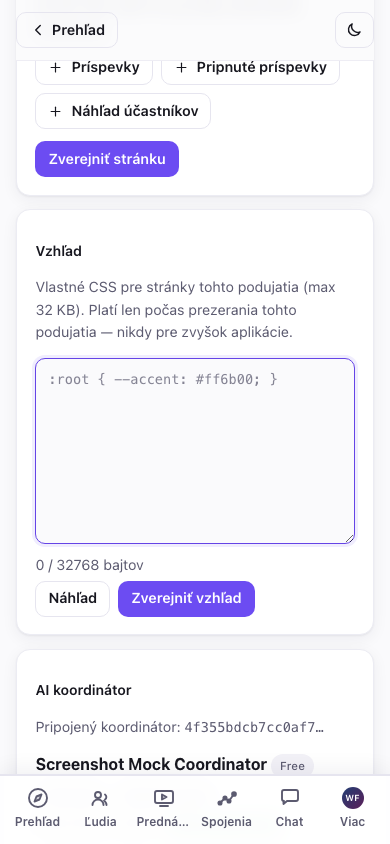

Toto je zatiaľ v ranej fáze: pripojenie do skupiny môže na strane servera chvíľu trvať aj po zapnutí, a v rozhraní je zámerne označené ako *Experimentálne* — zatiaľ sa naň nespoliehajte ako na jediný spôsob, ako sa dostať k účastníkom počas podujatia. Príspevky (§6) zostávajú spoľahlivým kanálom.

## 7. Počas podujatia

- **Zoznam účastníkov sa dopĺňa naživo** — schválení účastníci sa objavujú, ako sa pripájajú; zoznamy spojení sa obnovujú, ako sa spracúvajú nové predstavenia.
- **Prepočítanie spojení** — po nápore nových príchodov klepnite na **↻ Prepočítať všetky spojenia** (vyžaduje koordinátora).
- **Spoluorganizátori** — v **Administrácia → Nastavenia → Spoluorganizátori** pridajte niekoho podľa jeho npub a zdieľajte plnú organizátorskú kontrolu (úprava podujatia, schvaľovanie, správa koordinátora). Ich kľúče sú im zabalené ako darček; prístup získajú, keď nabudúce otvoria podujatie. Toto je zároveň vaša záchranná sieť, ak vám padne prehliadač.
- **Podnecujte predstavenia včas.** Spojenia existujú len pre ľudí, ktorí nahrali predstavenie — najlepšie, čo môžete pre kvalitu spojení urobiť, je dostať všetkých k nahratiu ešte pred začiatkom podujatia. Nahratie je pre účastníkov voliteľné a aplikácia im to aj hovorí, no oplatí sa na to tlačiť: nahraté predstavenie dá AI viac na prácu, umožní ostatným účastníkom vopred zistiť, či by si s daným človekom naozaj sadli, ešte skôr než k nemu podídu — párovanie nie je len o projektoch a zručnostiach, je to aj pocit, ktorý AI sama o sebe nedokáže zachytiť — a ak ide o video, pomôže ľuďom spoznať svoje spojenia naživo.

## Riešenie problémov a časté otázky

- **Čo vidia účastníci, kým nie sú schválení?** Iba verejnú stránku podujatia — názov, zhrnutie, dátumy, miesto a vaše zverejnené novinky. Zoznam účastníkov, videá a spojenia sú zašifrované pre schválených účastníkov.

- **Otvoril(a) som podujatie na inom zariadení a nie je tam tlačidlo administrácie.** Prihláste sa s tou istou identitou (vložte tajný kľúč, ktorý ste si zálohovali pri vytváraní účtu) a znova otvorte podujatie — organizátorský prístup ku každému podujatiu, ktoré ste vytvorili, sa v súčasnej verzii automaticky obnoví z tohto jediného kľúča, žiadna samostatná záloha podujatia netreba. Vaše kľúče podujatia sa načítajú z relayov v okamihu prihlásenia, takže na novom zariadení dajte aplikácii pár sekúnd, kým usúdite, že to nefunguje. (Pridanie **spoluorganizátora** z pôvodného zariadenia, s npub nového zariadenia, je stále najrýchlejšia možnosť, ak máte pôvodné zariadenie poruke.)

- **Pozývací odkaz niekoho automaticky neschválil.** Automatické schvaľovanie potrebuje pripojeného *a bežiaceho* koordinátora. Bez neho žiadosti z pozvánok stále prídu do vášho zoznamu **Žiadosti o pripojenie** — schváľte ich tam. (Budú mať značku **pozvánka**.)

- **Žiadosť o pripojenie sa nezobrazuje.** Klepnite na **Obnoviť** v hlavičke administrácie — žiadosti sa načítavajú na požiadanie. Ak sa stále neobjaví, účastník môže mať nestabilné pripojenie; požiadajte ho, nech znova otvorí odkaz na podujatie a žiadosť odošle znova.

- **Ako premietnem zoznam účastníkov / tabuľu spojení na mieste konania?** Otvorte zoznam účastníkov podujatia v prehliadači premietacieho počítača, prihlásení ako schválená identita (vy sami). Je to bežná stránka — dajte ju na celú obrazovku.

- **Môžem podujatie po vytvorení upraviť?** Novinky môžete zverejňovať a upravovať voľne. Spravovať podujatie môžu aj spoluorganizátori. Základné polia (názov, dátumy) sa v súčasnej verzii z tejto obrazovky upraviť nedajú — zmeny oznámte cez príspevok.
