# Nostrautica — Participant Guide

Someone invited you to an event that runs on Nostrautica. Here's the deal:
you record a short video introducing yourself, and before the event starts
the app tells you **exactly who there is worth meeting — and why**. No more
hoping you bump into the right person at the coffee machine.

Five minutes of setup, all on your phone.

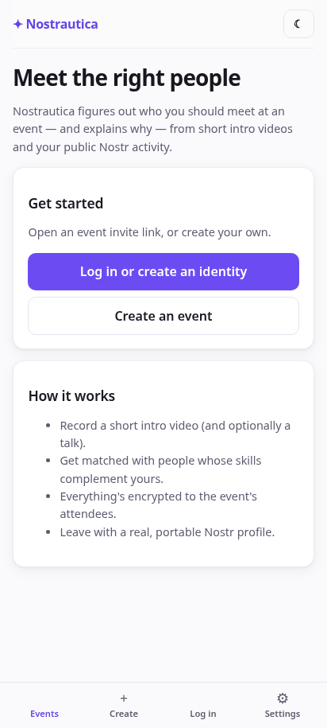

## 1. Open your invite link

Tap the link you were given. You'll see the event's **Overview** — what it is,
when, where — and a button to join. If the organizer has posted any
announcements, the latest show up here too.

Once you're in an event, the bar along the bottom is all about *this* event:
**Overview** (where you are now), **People**, **Matches**, **Updates**, and
**More** (your account, settings, other events). A small header at the top always
tells you which event you're in and whether you're a visitor, waiting, or in.

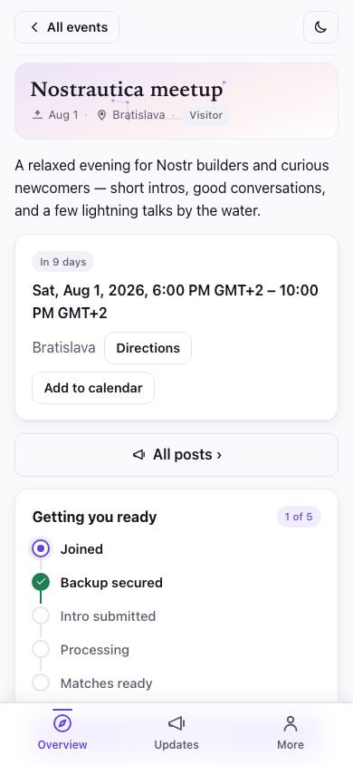

## 2. Join

Tap **Join this event** and fill in how people should know you:

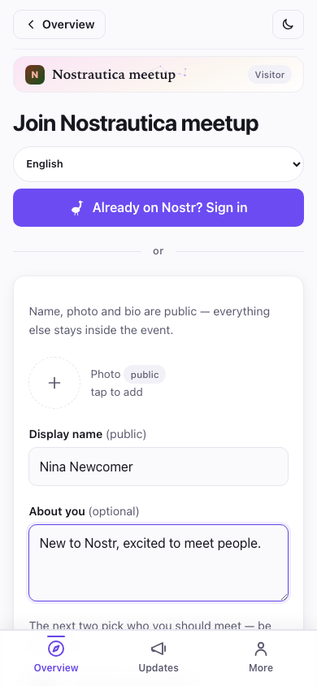

- **Photo, name, and "About you"** — this is your public profile, like any
  social app. The form says so: *"Name, photo and bio are public — everything
  else stays inside the event."*
- **Skills** and **What are you looking for?** — this is what the matching runs
  on. Be concrete: "rust developer, looking for a co-founder" beats "tech
  enthusiast". It's worth the extra minute.
- There's a checkbox to **publish a public RSVP** if you want others to see
  you're attending. Leave it off to keep your attendance inside the event.

No email, no password, no signup. When you tap **Create identity & join**, the
app makes a portable identity for you on the spot (more on that at the end —
it's a nice bonus).

> **Already use one of these?** If you tap **Already on Nostr? Sign in**, you
> can sign in with your existing key, a browser extension, or a phone signer
> app (like Amber or Clave) instead. Your existing profile carries over and is
> shown read-only — the app never changes it — and only the event-specific
> fields (skills, looking-for) are yours to fill in.
>
> 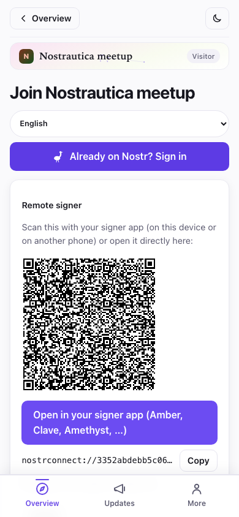

After you submit, one of two things happens depending on your link:

- **You're in right away** (invite links, when the organizer's matchmaking
  service is running) — you'll see a "You're in" screen with a button to see
  who's here:

  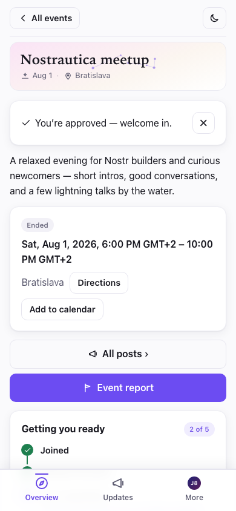

- **The organizer approves you shortly** — you'll see a "waiting for approval"
  screen. You can close the app; you'll get in as soon as they approve.

  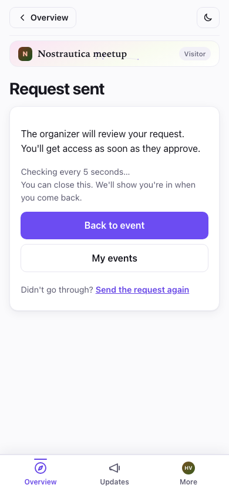

Back on **Overview**, a short **"Getting you ready"** checklist tracks exactly
where you are — Joined → Backup secured → Intro submitted → Processing →
Matches ready — and shows you the *one* next thing to do, front and center. No
guessing why matches haven't appeared yet: the list tells you.

### Save your key (30 seconds — actually do it)

After joining, the app shows a **backup card** with your secret key. Tap **Copy
my secret key** and paste it into your password manager. It's the only way back
into your account if you lose your phone — there's no "forgot password" email,
because there's no company holding your account. ("More ways to back up" can
email you a recovery link or make a password-protected file.)

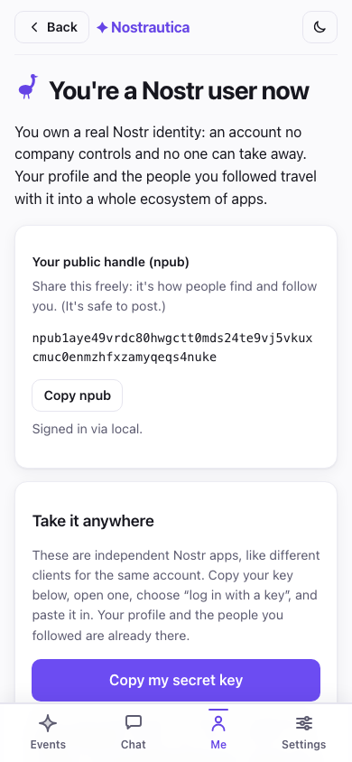

## 3. Record your intro

This is the important part — **no intro, no matches**. From the event page, tap
**Record / update your intro**, tap **Enable camera**, then **● Record**. Talk
for up to a minute: who you are, what you're working on, what you're looking
for. Hit **■ Stop** (it also stops itself at the time limit), watch it back,
and tap **Use this** — or **Re-record** until you're happy. Nobody outside this
event's attendees can ever see it.

**Use whatever language you like.** Record your intro and write your profile in
the language you're most comfortable in — it doesn't have to match the event's
language. The app writes your matches and summaries in the event's language, and
if your bio is in a different language it shows everyone a translation with your
original one tap away ("show original"). So just be yourself in your own words.

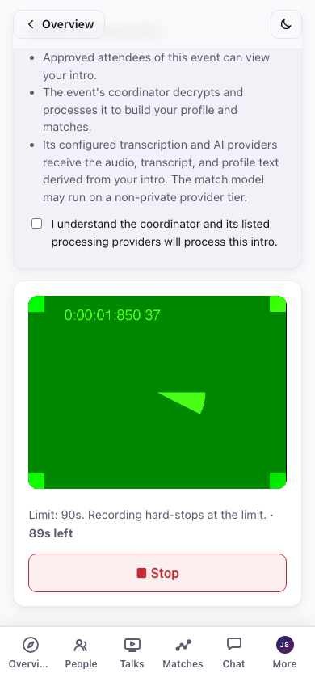

## 4. People

Tap **People** in the bottom bar to browse who's here. Each row shows an avatar
(their photo, or their initials on a coloured tile), their name, and their
skills. **Search** by name or skill, and filter to just the people you've marked
**want to meet**, **met**, **favorited**, or people you **follow** on Nostr.

The roster is **encrypted to approved attendees**, so until you're approved (or
in the moment right after, before it syncs) the People screen stays empty and
tells you why — that's the privacy model working, not a bug:

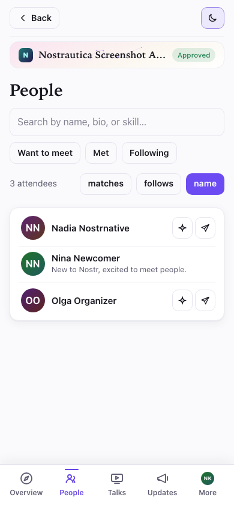

Once you're in, tap anyone to open their page: their intro video, what they do,
what they're looking for, an AI-written summary once the matchmaking has run, and
their recent public posts.

On a person's page you can **Follow** them, tap **Message** to start a private
chat (see §6), and — privately, nobody else ever sees these — mark **Favorite**,
**Want to meet**, or **Met ✓**, and keep a private note ("the drummer with the
mesh-network startup"). Reload and it all persists. If someone's bothering you,
**Mute** hides them from your People list, Matches, and messages (it's a standard
Nostr mute, so it carries to other Nostr apps too):

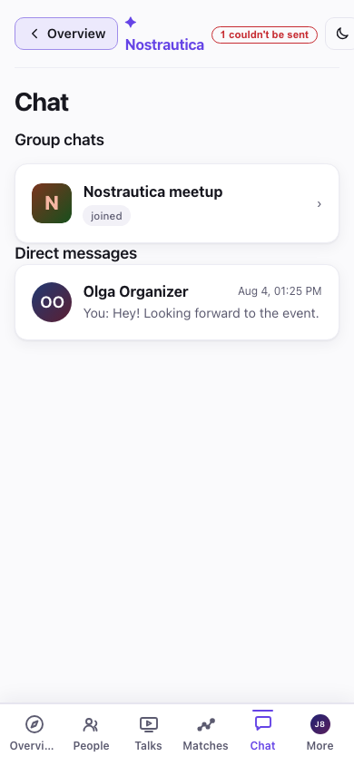

## 5. Your matches

Shortly after you record your intro, tap **Matches**: a ranked list of people to
meet. Each one leads with how strong the match is — **Strong match** or **Good
match** — and, most importantly, a plain-language explanation of *why you two
should talk*, right up front. If you want the mechanics (how similar vs. how
complementary you are), they're one tap away under "score details" — but the
reason comes first. The list updates as more people join. Tap a match to open
their full page.

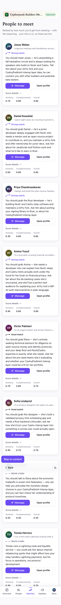

At the event, work the list: find your top matches, mention the app told you to.
Best icebreaker there is.

> Matches only appear once the organizer's coordinator has processed a few
> people's intros — so if the list says "no matches yet", it just means the room
> is still warming up. Record your own intro first (§3); that's what puts you in
> everyone else's matches.

## 6. Message people

Anyone's page has a **Message** button. Tap it to open a private,
**end-to-end encrypted** conversation:

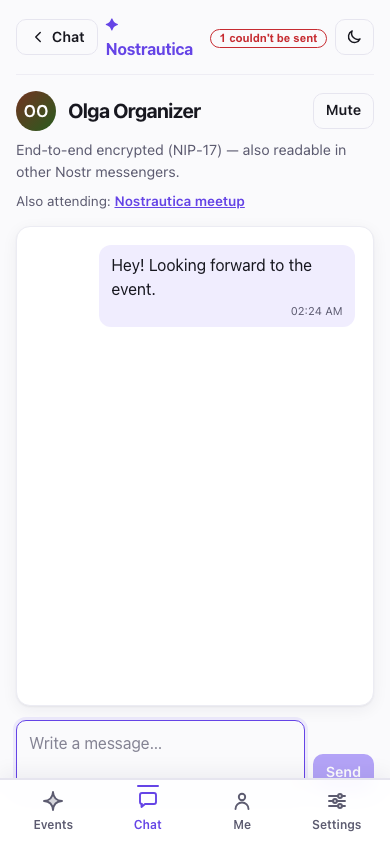

Your messages live under **More → Messages**, which lists every conversation,
newest first:

Because these are standard Nostr private messages, **they also work with other
Nostr messengers** — the person can reply from whatever Nostr app they use, and
your conversation shows up there too. It isn't locked to this event.

## 7. Afterwards: your profile is yours to keep

Surprise: the account you just used is a **Nostr identity** — a login you own,
not tied to this app or any company. Open **More → Your identity** to see your
public handle (your *npub*), copy your key, and jump to other Nostr apps.

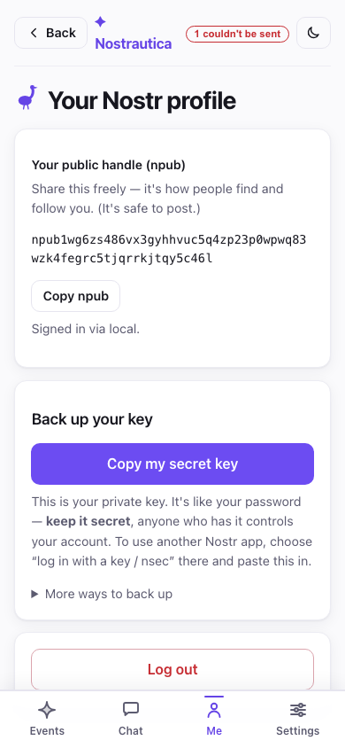

The people you followed at the event, your profile, all of it works across a
whole ecosystem of social apps (Primal, Damus, Amethyst, Yakihonne…). Copy your
key, open one of them, choose "log in with a key", and paste it in — you're
already there.

One more thing: **More → Settings** has a dark mode and a language switch
(English / Slovenčina), and your choice sticks:

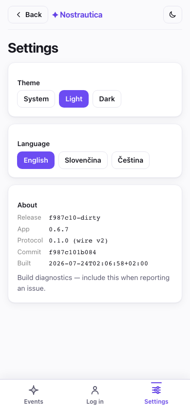

> **Organizer posts and members-only notes.** Under **Updates** you'll find the
> organizer's announcements. Some may be **members-only** — encrypted so only
> approved attendees can read them (the after-party address, a door code). If you
> ever see a post with a lock and "join the event to read this", that's a
> members-only post you don't yet have access to.

## Privacy, in one paragraph

Your name, photo, and bio are public (that's your profile). Your intro video,
the attendee list, and your matches are **encrypted so only this event's
approved attendees can see them** — not the public, not people who weren't let
in. Your favorites and private notes are encrypted so **only you** can see
them. Your messages are end-to-end encrypted between you and the other person.
The matching runs on an AI service chosen by the organizer, which reads intros
and profiles to write its recommendations. Here's what a non-attendee sees if
they open the attendee list — nothing:

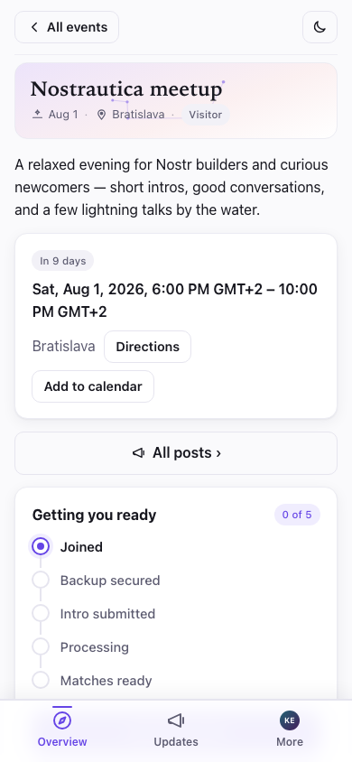

## Troubleshooting

- **I'm still "waiting for approval".** Unless you used an invite link, the
  organizer approves people by hand — give it a few minutes, or find them at the
  event. You can safely close the app; check back by reopening the event link.

- **My camera won't start.** Your phone or browser is asking for camera
  permission — look for the prompt (often in the address bar) and allow it. If
  there's no prompt, try another browser.

- **I got a new phone, or cleared my browser.** Open the app, tap **Already on
  Nostr? Sign in → Paste a key**, and paste the secret key you saved when you
  joined. Same account, same events. (This is why saving that key matters.)

- **No matches are showing yet.** Record your intro first — no intro, no
  matches. After that, matches take a little while to compute and need a few
  other people to have joined and recorded too. Check back soon.

- **I don't see the attendee list / videos.** You have to be approved first. If
  you were just approved, reopen the event and give it a moment.
